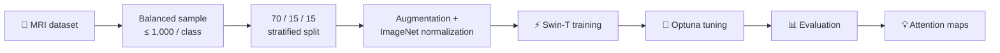

# 🧠 NeuroVision

<div align="center">

### Explainable dementia-stage classification from brain MRI scans

[](https://www.python.org/)
[](https://pytorch.org/)
[](main1.ipynb)
[](#disclaimer)

*A Swin Transformer pipeline for four-class dementia classification, backed by transparent visual explanations.*

</div>

---

> [!IMPORTANT]
> **Research and educational use only.** This project is not a medical device and must not be used to diagnose, treat, or make clinical decisions.

## ✨ At a glance

| | |
|---|---|
| **Task** | Multi-class dementia-stage classification from MRI images |
| **Classes** | Non Demented · Very mild Dementia · Mild Dementia · Moderate Dementia |
| **Backbone** | ImageNet-pretrained Swin Transformer Tiny |
| **Interpretability** | Grad-CAM-style shifted-window attention maps |
| **Evaluation** | Accuracy, confusion matrices, ROC, and precision–recall curves |

## 🗺️ Workflow



## 🚀 Quick start

```powershell
# 1. Clone and enter the project
git clone <your-repository-url>
cd AIT

# 2. Create and activate a virtual environment
python -m venv .venv
.\.venv\Scripts\Activate.ps1

# 3. Install dependencies
pip install -r requirements.txt

# 4. Launch the notebook
jupyter notebook main1.ipynb
```

> On first use, torchvision downloads the pretrained Swin-T weights automatically. A CUDA-enabled PyTorch build is recommended for training.

## 📁 Dataset setup

The notebook discovers class folders beneath `/kaggle/input`, making it immediately compatible with a Kaggle notebook environment. It expects these directory names (case and underscores are handled flexibly):

```text
dataset-root/
├── Mild Dementia/
├── Moderate Dementia/
├── Non Demented/
└── Very mild Dementia/
```

For local execution, update the discovery path in [`main1.ipynb`](main1.ipynb) from `/kaggle/input` to your data directory. Keep MRI data outside this repository: scans may be large and can be sensitive.

## 🔬 Method

### Data preparation

- Samples up to **1,000 images per class** to limit class imbalance.
- Uses deterministic seeds and a stratified **70% / 15% / 15%** train-validation-test split.
- Resizes scans to **224 × 224** pixels and applies ImageNet normalization.
- Augments training images with horizontal flips and ±10° rotation.

### Training & tuning

The model starts with pretrained **Swin Transformer Tiny** weights and replaces its classifier head for four output classes. Training combines class-weighted cross-entropy, label smoothing, AdamW, gradient clipping, and cosine annealing. Optuna searches learning rate, weight decay, and dropout with successive-halving pruning before the final 15-epoch training run.

### Evaluation & explainability

The notebook produces:

- Training/validation loss and accuracy curves
- Raw and normalized confusion matrices
- Per-class ROC and precision–recall curves
- Overall and per-class test accuracy
- Shifted-window Grad-CAM visualizations over MRI scans

## 🧰 Stack

`PyTorch` · `torchvision` · `Optuna` · `scikit-learn` · `OpenCV` · `NumPy` · `Matplotlib` · `Seaborn` · `Pillow`

See [requirements.txt](requirements.txt) for the complete installable dependency list.

## 📂 Project layout

```text
AIT/
├── main1.ipynb        # End-to-end experiment and visualizations
├── requirements.txt   # Python dependencies
├── .gitignore         # Local, data, model, and notebook artifacts
└── README.md          # Project guide
```

## ⚠️ Disclaimer

Machine-learning predictions can be wrong, biased, or unreliable outside the data distribution used for training. Validate rigorously with appropriate clinical oversight before considering any real-world use. Never use this notebook as a substitute for professional medical judgment.
